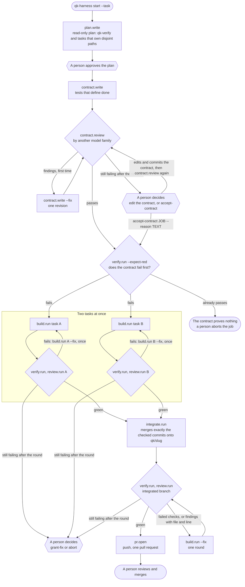

# qk-harness

[Tiếng Việt](README.vi.md) · [Guide](docs/en/guide.md) · [Measurements](docs/en/measurements.md) · [Changelog](CHANGELOG.md)

A personal agent harness. It runs one piece of work that has several tasks on top of [qk](https://github.com/dakiquang/qk): a contract written and reviewed before any build, workers on separate worktrees (two at a time), integration onto one branch, a review by a different model family, at most one fix round per task and for the integration, and one pull request. It never merges; a person does.

qk-harness depends on qk one way. It uses only qk's versioned [CLI contract](https://github.com/dakiquang/qk/blob/v0.10.0/docs/en/cli-contract.md), never imports qk's Python modules, and runs the qk pinned in [`qk.lock`](qk.lock), not the one installed on the machine.

For work with one task, use qk's own `qk-run`: it is cheaper and faster. The harness is for work that splits into tasks that can be built side by side.

## How it works

A Medium job, the default. A Large job also stops for approval after the contract, the build and the integration; `--no-contract` skips the contract stage, and each task gets one fix round of its own before a person decides, like the integrated branch. When the contract review still fails after its one revision round, a person either edits and commits the contract and runs `contract.review` again, or accepts the remaining findings with `qk-harness accept-contract JOB --reason TEXT`; the job then goes on to the red check as if the review had passed, and a new `contract.review` clears the acceptance. The [guide](docs/en/guide.md) explains every capability.



## Install

Python 3.9+, `git`, `gh` (for pull requests) and the runtimes you name (`codex`, `claude` or `omp`). No Python packages.

```bash
git clone https://github.com/dakiquang/qk-harness.git ~/src/qk-harness
mkdir -p ~/.local/bin
ln -s ~/src/qk-harness/bin/qk-harness ~/.local/bin/qk-harness
qk-harness doctor
```

`doctor` fetches the qk tag named in `qk.lock` into the state directory, checks that the tag still points at the locked commit, and checks qk's contract version. Use an unused link name, and put `~/.local/bin` on your `PATH`. Without the link, `python3 -m harness` from the clone does the same.

## Quick start

```bash
qk-harness start --repo ~/src/project --task "Add CSV export and an export button"
qk-harness run JOB          # writes the plan, then stops for you
qk-harness approve JOB plan
qk-harness run JOB          # contract, tasks, integration, review, pull request
qk-harness status JOB
qk-harness status --line    # all unfinished jobs, one line each
```

Overnight, `qk-harness run JOB --until 07:00` waits out a usage limit instead of stopping. When a task has used its one fix round, `qk-harness grant-fix JOB TASK` gives it one more; see [everyday commands](docs/en/guide.md#running-and-resuming).

`run` stops at every gate, at any step that is blocked, and when a person must decide; `status` and every reply name the next step. The [guide](docs/en/guide.md) explains each capability, the gates, the options and the limits.

## Status

Version 0.1.0. Built and tested against a stand-in qk; measured with real agents on two of qk's single-task eval cases ([measurements](docs/en/measurements.md)). One real job with two tasks has reached its pull request, with a person granting one extra fix round.

## Test

```bash
python3 -m unittest discover -s tests
```

The tests use a stand-in qk (`tests/fake_qk.py`) and a scripted agent (`tests/fake_agent.py`); they need no network and run no real agent.

## License

MIT; see [LICENSE](LICENSE).
