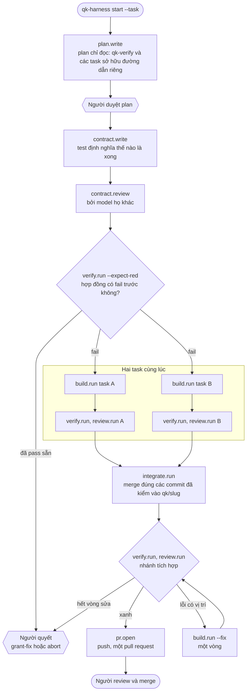

# qk-harness

[English](README.md) · [Hướng dẫn](docs/vi/guide.md) · [Số đo](docs/vi/measurements.md) · [Changelog](CHANGELOG.md)

Một agent harness cá nhân. Nó chạy một việc có nhiều task trên nền [qk](https://github.com/dakiquang/qk): hợp đồng được viết và review trước khi build, mỗi task một worktree (chạy hai task cùng lúc), gộp vào một nhánh, review bởi một họ model khác, mỗi task và phần tích hợp tối đa một vòng sửa, và một pull request. Harness không bao giờ merge; người merge.

qk-harness phụ thuộc qk một chiều. Nó chỉ dùng [hợp đồng CLI](https://github.com/dakiquang/qk/blob/v0.10.0/docs/vi/cli-contract.md) có phiên bản của qk, không import module Python của qk, và chạy bản qk khoá trong [`qk.lock`](qk.lock), không phải bản cài trên máy.

Việc chỉ có một task thì dùng `qk-run` của qk: rẻ và nhanh hơn. Harness dành cho việc tách được thành nhiều task build song song.

## Cách hoạt động

Một job Medium, loại mặc định. Job Large dừng thêm để duyệt sau hợp đồng, sau build và sau tích hợp; `--no-contract` bỏ bước hợp đồng, và mỗi task cũng có một vòng sửa riêng. [Hướng dẫn](docs/vi/guide.md) giải thích từng capability.



## Cài

Cần Python 3.9+, `git`, `gh` (để mở pull request) và các runtime bạn dùng (`codex`, `claude` hoặc `omp`). Không cần gói Python nào.

```bash
git clone https://github.com/dakiquang/qk-harness.git ~/src/qk-harness
mkdir -p ~/.local/bin
ln -s ~/src/qk-harness/bin/qk-harness ~/.local/bin/qk-harness
qk-harness doctor
```

`doctor` tải tag qk ghi trong `qk.lock` vào thư mục trạng thái, kiểm tag vẫn trỏ đúng commit đã khoá, và kiểm phiên bản hợp đồng của qk. Dùng tên link chưa ai dùng, và đưa `~/.local/bin` vào `PATH`. Không tạo link thì chạy `python3 -m harness` trong thư mục clone cũng được.

## Bắt đầu nhanh

```bash
qk-harness start --repo ~/src/project --task "Thêm xuất CSV và nút xuất"
qk-harness run JOB          # viết plan rồi dừng chờ bạn
qk-harness approve JOB plan
qk-harness run JOB          # hợp đồng, các task, tích hợp, review, pull request
qk-harness status JOB
qk-harness status --line    # mọi job chưa xong, mỗi job một dòng
```

Qua đêm, `qk-harness run JOB --until 07:00` chờ hạn mức mở lại thay vì dừng. Khi task đã dùng hết vòng sửa duy nhất, `qk-harness grant-fix JOB TASK` cho nó thêm một vòng; xem [các lệnh hằng ngày](docs/vi/guide.md#chạy-và-chạy-tiếp).

`run` dừng ở mỗi cổng, ở bước bị chặn, và khi cần người quyết; `status` và mọi câu trả lời đều nêu bước tiếp theo. [Hướng dẫn](docs/vi/guide.md) giải thích từng capability, các cổng, tuỳ chọn và giới hạn.

## Trạng thái

Phiên bản 0.1.0. Đã build và test với một qk giả; đã đo với agent thật trên hai bài eval một task của qk ([số đo](docs/vi/measurements.md)). Một job thật có hai task đã đi tới pull request, với một vòng sửa do người cấp thêm.

## Test

```bash
python3 -m unittest discover -s tests
```

Test dùng một qk giả (`tests/fake_qk.py`) và một agent theo kịch bản (`tests/fake_agent.py`); không cần mạng và không chạy agent thật.

## Giấy phép

MIT; xem [LICENSE](LICENSE).
