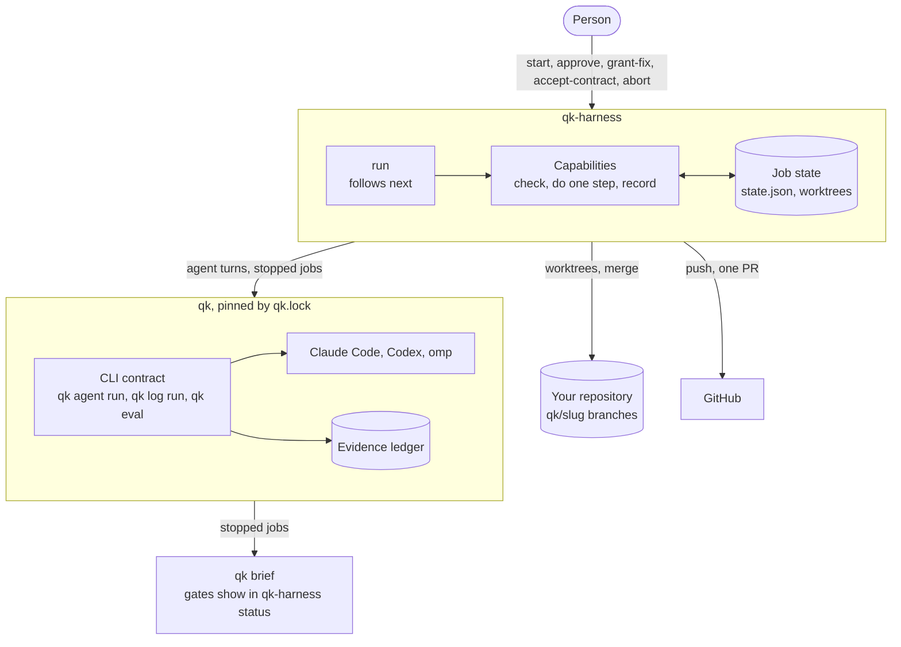

# qk-harness guide

[Tiếng Việt](../vi/guide.md) · [README](../../README.md) · [Measurements](measurements.md)

## The idea

The durable part of an agent harness is its commitments: who may do what, what must be true before each step, and what evidence each step leaves. The order of steps is the part that ages fastest. So qk-harness is two layers:

- **Capabilities**, each one command that checks its own preconditions from the job state, does one step, records it, and replies with `status`, `reason` and `next`.
- **A thin coordinator** (`run`) that only follows `next`. Calling a capability by hand gets exactly the same checks and refusals.

Three roles stay separate: agents make and check, the harness runs git, and a person approves stages or explicitly delegates one job, and alone decides to merge.



## A job

`qk-harness start --repo PATH --task TEXT` creates a job; nothing runs yet. Options:

| Option | Meaning |
|---|---|
| `--size medium` (default) | One gate: the plan |
| `--size large` | Gates after the plan, the contract, the build and the integration |
| `--base BRANCH` | Default: the repository's current branch |
| `--impl SPEC`, `--review SPEC` | `runtime:model` that builds and reviews; default `codex:gpt-6.1-terra` and `claude:`. They must be different model families |
| `--no-contract` | Skip the contract stage; each task writes the tests that check it |
| `--no-task-review` | Review only the integrated branch |
| `--sequential` | One task at a time (default: two at once) |

Job state lives in `$QK_HARNESS_STATE_DIR`, else `$XDG_STATE_HOME/qk-harness`, else `~/.local/state/qk-harness`: one directory per job with `state.json`, the plan, diffs, the agent turns and every worktree. Nothing is written into your repository except the branches `qk/<slug>` and `qk/<slug>--<task>`, their worktrees' registration, and the upstream of `qk/<slug>` once `pr.open` pushes it.

## Delegating one job

Manual gates remain the default. Before planning, a person may authorize one job to continue through its gates and publish a PR. This retains the contract, per-task reviews, cross-family checks and normal fix rounds; it never authorizes merge, release, extra fix rounds or extra PR audits.

```bash
qk-harness start --repo ~/src/project --task "Add CSV export" --size large \
  --impl codex:gpt-6.1-terra --review claude:sonnet
qk-harness authorize JOB --path src --path tests --path README.md --path CHANGELOG.md \
  --budget-usd 5 --turn-estimate-usd 0.5 --gh-user your-login
qk-harness run JOB --until 07:00
```

Replace `JOB`, the paths, login and illustrative USD amounts with the reviewed scope/model estimates. `authorize` is the user granting authority, not a preview. It binds the task, repo, base commit, models/options, job branch and origin; all planned contract/task paths must fit the supplied paths. The planning checkout must match the base. Task-specific model overrides outside the approved pair are refused. A grant is not an OS sandbox or a shell-command allowlist; plan/check commands are still trusted code, and contract review also checks the plan against the original task.

`authorize` checks the selected GitHub token, account and repository permission before saving the grant, so a bad publisher fails before model spending. A failed preflight leaves the previous grant unchanged. Publication checks them again; credentials or permissions can change in between.

Run the last command in a Terminal/process independent of the chat session. The CLI needs no agent session to approve its stages. `approve JOB STAGE --delegated` is the actual transition recorded by the runner: `actor=delegated` plus the user grant hash, not another human signature. State and usage survive resume; the command does not install a daemon or survive shutting down its own Terminal/machine.

The budget is a **soft stop for reported USD**, not a hard cap: before a new turn the runner checks spent USD plus concurrent reservations and the next non-Codex turn estimate. In-flight turns may exceed the estimate/budget. Missing Codex USD remains unknown and assumes the existing quota is authorized, not API purchases; the caller must verify that billing setup. Missing non-Codex USD stops further turns. Pending usage is saved before invocation; a killed model turn with unresolved cost stops resume for inspection instead of being retried as free work. No automatic reconciliation or clearing of those unresolved records is claimed.

`status JOB` and the final reply include authority, budget (known/unknown/reserved) and CI. Raise the budget or change scope only with a new explicit `authorize` command; it keeps prior usage and grant history. `revoke JOB --reason TEXT` prevents further work once the state lock is available; it does not cancel an in-flight turn. The CI wait holds that lock for up to 30 minutes, delaying revoke/abort. A revoked job needs a new `authorize` or `abort`; revocation does not silently switch it to manual mode. Job mutation, changed plan/origin or revocation stops delegation.

Publishing obtains credentials for `--gh-user` only in Git/gh children, without changing stored auth/config. It checks account, repository and reviewed head, publishes only the job branch, and uses an evidence summary rather than the private plan as PR body. After publication, `pr.check` waits up to 30 minutes for the PR's exact head: absent/pending/all-skipped checks or unfinished GitHub Actions runs are not success; failure or head/base/state drift blocks the job. A new `run` rechecks CI without rebuilding or duplicating the PR. CI red does not authorize a post-PR fix loop. Merge remains the person's decision.

CI observes reported checks and registered Actions runs for this head, not workflows/checks GitHub has not registered yet; it does not define a required-workflow allowlist. The selected token must also be able to read the repository's Actions runs.


## The plan

`plan.write` asks the implementer to follow qk's `qk-plan` skill read-only and return a plan with two blocks:

- ```` ```qk-verify ````: shell commands that prove the whole result. A plan without one is refused: the harness only runs work it can check.
- ```` ```qk-harness ````: `{"contract": ["tests/..."], "tasks": [{"name", "owns", "verify", "impl"?, "review"?}]}`. Each task owns repository paths no other task owns and lists the commands that check it alone. Without a contract stage there is no `contract` key and each task owns its own tests.

Ownership overlaps and role families are checked when the plan is written, before any worker runs. An approval records the plan's hash; editing the plan afterwards makes every later step refuse.

## The capabilities

| Capability | What it may change | Main preconditions |
|---|---|---|
| `plan.write` | nothing | clean checkout; plan not approved |
| `contract.write [--fix]` | the integration worktree, only under the contract paths | plan approved; `--fix` once after a failed contract review |
| `contract.review` | nothing | a contract; reviewer from another family; a new review clears an acceptance |
| `build.run TASK [--fix]` | the task's own worktree, only its paths | contract reviewed or accepted, and shown red (and approved for large jobs); `--fix` once, and once more per `grant-fix` |
| `build.run integration --fix` | the integration worktree, only the tasks' paths | integrated branch failed its checks or review; once, and once more per `grant-fix` |
| `verify.run TARGET [--expect-red]` | nothing; runs one verification at a time across jobs | a built task, or the integrated branch; `--expect-red`: a contract whose review passed or was accepted |
| `review.run TARGET` | nothing | target passed its checks; reviewer from another family than every implementer it checks |
| `integrate.run` | the local branch `qk/<slug>` | every task built, checked and reviewed; nothing running |
| `pr.open` | the remote: pushes `qk/<slug>`, opens one pull request | integrated branch checked and reviewed; last gate approved; the active `gh` account can push |
| `pr.check` | nothing | delegated published job; waits for reported CI on the exact reviewed head before `done` |

Rules the code enforces, not the prompt:

- Only the harness may commit or switch branches. Changed branch/commit and out-of-ownership paths are refused after a worker turn; this is not a ban on every read-only Git command or an OS sandbox.
- Agents are given their own worktree and the shared plan/diff directory, not other task worktrees; this describes supplied context, not filesystem isolation against arbitrary shell commands.
- The contract must fail before any build (`--expect-red`); a contract that already passes stops the job.
- Integration merges exactly the commits that were checked and reviewed; a branch that moved since stops the job.
- A fix round takes only failed checks and findings that name a file and a line. Anything else waits for a person.
- A task worker is judged only by its own task's checks. Tests of the plan's other tasks may fail in its worktree until integration; a test it would add outside its paths goes into its summary instead of stopping the task.
- Once the tasks are integrated, only the integrated branch moves on; a task can no longer be built, checked or reviewed on its own.
- A test that asks for behaviour the plan does not state is an important finding.

## Running and resuming

`qk-harness run JOB` (also `resume`) runs each next step until a gate, a blocked step, a person's decision or the end; two task turns run at once, each in its own `qk agent run` process. Before it starts, it clears tasks left `running` by a process that is gone. It never builds over a branch commit the job did not record, and `pr.open` reuses a pull request that already exists.

A turn that stops at its runtime's usage limit (qk reports it as `limit` in `qk agent run`) does not fail the job and uses no fix round: the job records `limits` and its next step becomes `wait: the <runtime> usage limit until HH:MM, then …`. Tasks whose turns use another runtime go on. `qk-harness run --until HH:MM` sleeps until two minutes after the reset (30 minutes when the runtime named no time), notifies (macOS), retries and carries on, at most three waits and never past the deadline; `--wait-limits` waits without a deadline and `--no-wait-limits` turns waiting off. Without them, `run` stops with `stopped: limited`, and running it again later retries. `status` shows the limits, and the ledger record carries `limited`, so `qk brief` shows `waiting for <runtime> limit until HH:MM`.

`approve JOB STAGE` records a person's approval. `grant-fix JOB TARGET [--reason TEXT]` gives a task (until the tasks are integrated) or `integration` one more fix round once its own is used, when it still fails its checks or has serious findings that all name a file and a line; anything else is refused, and the job's log keeps the decision and its reason. `accept-contract JOB --reason TEXT` lets the job go on with a contract whose review still fails after its one revision round and that has not been checked red yet; a blank reason is refused. The contract keeps the reason, the time and the serious findings accepted, the job's log keeps the decision, and a new `contract.review` clears the acceptance. The red check and, for large jobs, the contract gate still apply. `abort JOB --reason TEXT` stops a job for good and lists the branches and worktrees it leaves for you to inspect or remove.

`qk-harness status` without a job lists unfinished jobs; use `--line` for status lines. A runtime adapter can read them by adding `qk-harness status --line` to `~/.config/qk/status-commands`. Lines look like this; several jobs that are not running share one line:

```text
harness aaea46 · review.run eval · 1/2 tasks
harness aaea46 · waits: approve plan
harness aaea46 · claude limit until 23:50
harness aaea46 · task api stopped mid-step · qk-harness run
harness 7 jobs not running (qk-harness status)
```

Everyday commands:

```bash
qk-harness status --line                     # every unfinished job, one line each
qk-harness run JOB --until 07:00             # overnight: wait out usage limits, but never past 07:00
qk-harness grant-fix JOB api --reason "the review findings are worth one more try"
qk-harness run JOB                           # the granted round runs: build.run JOB api --fix
qk-harness accept-contract JOB --reason "the findings are stricter than the plan"
qk-harness abort JOB --reason "replaced by a smaller plan"
```

A job waiting for a person says so in `next`, for example `a person decides: task api has serious review findings that a fix round cannot take`. Run `qk-harness status JOB` to see `findings`: the serious review findings behind that decision, for the contract (`target` is `contract`), a task, or `integration`. Each entry has `target`, `severity`, `file`, `line`, and `claim`; a missing location is shown as null. The list can be empty when the decision has another cause. Depending on the circumstances, grant an eligible target another round or abort the job.

When a job stops (done, blocked, aborted, or waiting for a decision; not at an approval gate) it is recorded in qk's evidence ledger with `qk log run --producer "qk-harness <version>"`, so it shows in `qk show`, `qk stats` and `qk brief`. A blocked card names qk-harness as the tool that resumes it, and says why the job stopped: the harness keeps that reason as `reason` at the top of the job's `state.json`, where `qk brief` reads it.

## Measuring

`qk-harness eval CASE [--impl SPEC] [--review SPEC] [--no-contract] [--no-task-review] [--repeat N]` runs one of qk's eval cases that builds something: `qk eval prepare`, a medium job whose plan gate the eval approves (recorded as such), no pull request, then `qk eval grade` on the integrated branch. The grader reads the harness's own four-line report. `result.json` keeps the criteria, every turn's tokens and time, and the case's baseline. It runs real agents and costs money. Results so far: [measurements](measurements.md).

For example, `qk-harness eval csv-export --repeat 3` runs the case three times and reports `pass_share`, the share of runs that passed every criterion (`0.666…` when two of three did).

Use `--repeat N` (a positive integer, default 1) to run the case sequentially N times. Each invocation has a unique directory under the state directory’s `evals/`, with numbered run directories containing `result.json` and a `summary.json` alongside them. The summary records each run’s directory, criteria, total tokens and elapsed seconds; `pass_share` is the fraction of runs where every criterion passed. Each repetition runs real agents again and adds to the cost.

The summary also includes each run's stop state, reason, next step, pass result and baseline. With one run, stdout also includes the full run result, including failed criteria details and totals. The command exits with code 0 when every run stops at `waiting` or `done`, even if grading fails; other stop states or errors yield code 2.

## Limits

- Real agents have been measured on two single-task eval cases. One real two-task job (Codex building, Claude reviewing) reached its pull request; it needed a fix to the build prompt and one fix round granted by a person. The same two-task work, run parallel and sequential without a contract, reached `pr.open` both times ([measurements](measurements.md)).
- An earlier Large job stopped before the contract gate after six contract reviews, each finding a new test stricter than the plan. A later manual Large job reached [WAF PR #11](https://github.com/dakiquang/waf-upgrade-check/pull/11) through four human gates, but had only one completion task. Neither is a real-agent delegated-job or multi-task proof. After the revision round a person can accept remaining contract findings with `accept-contract JOB --reason TEXT`; delegation never grants that decision automatically.
- One job runs at a time per coordinator; there is no daemon or queue.
- The harness does not merge, release, tag, delete branches or force-push, and has no capability that could.
- Runtimes: `codex`, `claude` and `omp`, as qk supports them.
