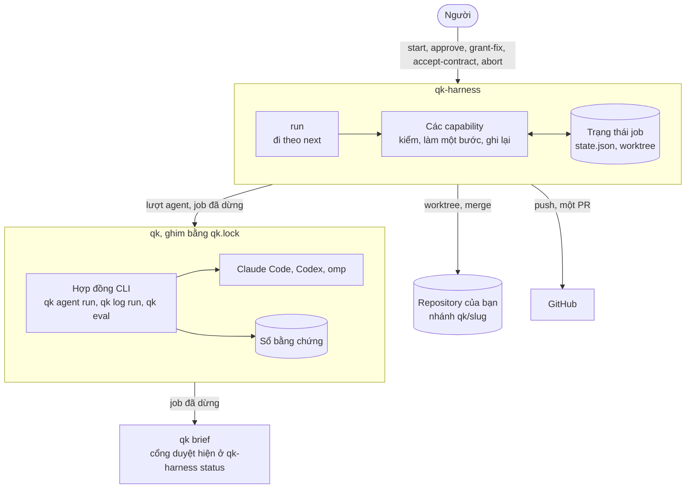

# Hướng dẫn qk-harness

[English](../en/guide.md) · [README](../../README.vi.md) · [Số đo](measurements.md)

## Ý tưởng

Phần bền của một agent harness là các cam kết: ai được làm gì, điều gì phải đúng trước mỗi bước, và mỗi bước để lại bằng chứng gì. Thứ tự các bước là phần lỗi thời nhanh nhất. Vì vậy qk-harness có hai lớp:

- **Các capability**, mỗi cái là một lệnh tự kiểm điều kiện tiên quyết từ trạng thái job, làm một bước, ghi lại, và trả `status`, `reason`, `next`.
- **Một coordinator mỏng** (`run`) chỉ đi theo `next`. Gọi tay một capability cũng bị kiểm và từ chối y như vậy.

Ba vai tách riêng: agent làm và kiểm, harness chạy git, người duyệt từng cổng hoặc cấp quyền cho đúng một job; merge luôn do người quyết.



## Một job

`qk-harness start --repo PATH --task TEXT` tạo một job; chưa chạy gì. Tuỳ chọn:

| Tuỳ chọn | Nghĩa |
|---|---|
| `--size medium` (mặc định) | Một cổng: plan |
| `--size large` | Cổng sau plan, hợp đồng, build và tích hợp |
| `--base BRANCH` | Mặc định: nhánh hiện tại của repo |
| `--impl SPEC`, `--review SPEC` | `runtime:model` làm và review; mặc định `codex:gpt-6.1-terra` và `claude:`. Phải khác họ model |
| `--no-contract` | Bỏ bước hợp đồng; mỗi task tự viết test kiểm nó |
| `--no-task-review` | Chỉ review nhánh tích hợp |
| `--sequential` | Từng task một (mặc định hai task cùng lúc) |

Trạng thái job nằm ở `$QK_HARNESS_STATE_DIR`, không có thì `$XDG_STATE_HOME/qk-harness`, không có nữa thì `~/.local/state/qk-harness`: mỗi job một thư mục có `state.json`, plan, diff, các lượt agent và mọi worktree. Harness không ghi gì vào repo của bạn ngoài các nhánh `qk/<slug>`, `qk/<slug>--<task>`, việc đăng ký worktree của chúng, và upstream của `qk/<slug>` khi `pr.open` push nó.

## Ủy quyền một job

Manual vẫn là mặc định. Trước khi lập plan, người có thể cấp quyền cho đúng một job tự đi qua các cổng và mở PR. Hợp đồng, review từng task, khác họ model và vòng sửa mặc định giữ nguyên; không cấp quyền merge, release, thêm vòng sửa hay thêm PR audit.

```bash
qk-harness start --repo ~/src/project --task "Thêm xuất CSV" --size large \
  --impl codex:gpt-6.1-terra --review claude:sonnet
qk-harness authorize JOB --path src --path tests --path README.md --path CHANGELOG.md \
  --budget-usd 5 --turn-estimate-usd 0.5 --gh-user your-login
qk-harness run JOB --until 07:00
```

Thay `JOB`, paths, login và số USD minh họa bằng phạm vi/model/dự toán đã xét. `authorize` chính là cấp quyền, không phải xem trước. Quyền gắn với task, repo, base commit, model/options, branch job và origin; đường dẫn contract/task của plan phải nằm trong paths đã cấp. Checkout lập plan phải đúng base. Model riêng của task ngoài cặp đã cấp bị từ chối. Grant không phải OS sandbox hay allowlist lệnh shell; lệnh plan/check vẫn là code được tin cậy, và review contract kiểm cả plan so với task gốc.

`authorize` kiểm token GitHub, tài khoản và quyền repo trước khi lưu grant để publisher sai bị chặn trước khi tốn tiền model. Preflight hỏng giữ nguyên grant cũ. Lúc publish vẫn kiểm lại vì credential hoặc quyền có thể đã đổi.

Chạy lệnh cuối trong Terminal/process độc lập với chat. CLI không cần phiên agent duyệt tiếp từng cổng. Runner thực hiện `approve JOB STAGE --delegated`, ghi `actor=delegated` và hash grant của người, không giả thêm chữ ký người. State và usage giữ qua resume; lệnh không cài daemon hoặc sống qua việc đóng chính Terminal/tắt máy.

Ngân sách là **soft stop cho USD runtime báo**, không phải trần cứng: trước lượt mới, runner xét USD đã tiêu cộng khoản dự trù của các lượt song song và lượt non-Codex kế tiếp. Lượt đã khởi chạy có thể vượt dự toán/ngân sách. Reply Codex terminal hợp lệ nhưng thiếu USD là unknown cost, không phải unknown execution; nó giả định quota hiện có đã được duyệt, không phải mua API, và người cấp quyền phải kiểm kiểu thanh toán đó. Non-Codex thiếu USD thì dừng lượt sau. Reply bị ngắt hoặc không hợp lệ là unknown execution bất kể runtime và chặn resume; không được coi là lượt Codex miễn phí. Xem [lỗi và bước bị ngắt](#lỗi-và-bước-bị-ngắt) cùng [`delegation.costs` / `check_turn`](../../harness/delegation.py).

`status JOB` và kết quả cuối có authority, budget (known/unknown/reserved) và CI. Muốn tăng ngân sách hoặc đổi scope phải cấp `authorize` mới rõ ràng; usage cũ và lịch sử grant được giữ, không xóa được guard unknown execution. `revoke JOB --reason TEXT` chặn việc tiếp theo khi đã ghi nhận; không hủy ngay model turn hay native request đang chạy. Có thể ghi revoke khi CI read còn pending; worker kiểm lại quyền trước khi tiếp tục hoặc nhận success. Job đã thu hồi cần `authorize` mới hoặc `abort`; không tự chuyển ngầm sang manual. Job bị đổi, plan/origin khác hoặc quyền bị thu hồi thì delegation dừng.

Publish chỉ lấy credential của `--gh-user` cho tiến trình Git/gh, không đổi auth/config lưu trên máy. Nó kiểm tài khoản, repo và head đã review, chỉ push branch job; body PR là tóm tắt evidence, không chép plan riêng tư. PR delegated tạo mới là draft cho pilot có kiểm soát; cách tạo PR manual không đổi, PR có sẵn được dùng lại mà không đổi trạng thái draft. Sau publish, `pr.check` chờ tối đa 30 phút cho đúng head, head branch, base và trạng thái OPEN: phải có ít nhất một SUCCESS được báo; checks vắng/pending/toàn skipped hoặc Actions run đã đăng ký nhưng chưa xong không phải xanh. CI hỏng hoặc head/base/state đổi làm job bị chặn. `run` mới kiểm CI lại, không build hoặc tạo PR trùng. CI đỏ không cấp thêm vòng sửa hậu PR. Merge vẫn do người.

CI dùng claim của job, thả job lock khi đọc mạng và polling. Một `run` khác báo `stopped: waiting`, không giành claim; danh sách status vẫn hiện `pr.check` đang chạy khi owner còn sống. Trước khi nhận kết quả phải kiểm lại claim, quyền và head; claim bị ngắt không tự được thu hồi. Owner là [`capabilities.run_ci`](../../harness/capabilities.py) và [`publication.check_ci`](../../harness/publication.py).

Chỉ logical PR read (`gh pr view`) hoặc Actions GET read bị timeout mới có thể được **tối đa hai lần thử tổng cộng: lần đầu cộng một retry**, khi cleanup đã xác nhận và quyền còn hợp lệ. Hai attempts, xác thực, polling và sleep dùng chung deadline CI 1800 giây; timeout native call rút xuống theo thời gian còn lại. Policy này không retry lỗi xác thực/quyền, lỗi khác, model turn hay Git ghi. Read thành công nhưng CI còn pending dẫn tới poll bình thường mới, không phải transport retry. [Cơ chế chờ usage limit của runtime](#chạy-và-chạy-tiếp) hiện có không đổi.

CI chỉ thấy checks và Actions runs GitHub đã đăng ký cho head này, không biết workflow/check chưa đăng ký; không đặt thêm allowlist workflow bắt buộc. Token được chọn phải có cả quyền đọc Actions runs của repo.


## Plan

`plan.write` yêu cầu bên làm theo skill `qk-plan` của qk ở chế độ chỉ đọc và trả về plan có hai khối:

- ```` ```qk-verify ````: lệnh shell chứng minh toàn bộ kết quả. Plan thiếu khối này bị từ chối: harness chỉ chạy việc kiểm được.
- ```` ```qk-harness ````: `{"contract": ["tests/..."], "tasks": [{"name", "owns", "verify", "impl"?, "review"?}]}`. Mỗi task sở hữu đường dẫn không task nào khác sở hữu và khai lệnh kiểm riêng nó. Không có bước hợp đồng thì không có khoá `contract` và mỗi task tự sở hữu test của mình.

Chồng đường dẫn và họ model của các vai được kiểm ngay khi viết plan, trước mọi worker. Lệnh duyệt ghi lại hash của plan; sửa plan sau khi duyệt thì mọi bước sau bị từ chối.

## Các capability

| Capability | Được đổi gì | Điều kiện chính |
|---|---|---|
| `plan.write` | không gì | checkout sạch; plan chưa duyệt |
| `contract.write [--fix]` | worktree tích hợp, chỉ trong đường dẫn hợp đồng | plan đã duyệt; `--fix` một lần sau review hợp đồng thất bại |
| `contract.review` | không gì | có hợp đồng; reviewer khác họ; lượt review mới xoá việc chấp nhận |
| `build.run TASK [--fix]` | worktree riêng của task, chỉ đường dẫn của nó | hợp đồng đã qua review hoặc được chấp nhận, và đã đỏ (job lớn: đã duyệt); `--fix` một lần, cộng một lần cho mỗi `grant-fix` |
| `build.run integration --fix` | worktree tích hợp, chỉ đường dẫn của các task | nhánh tích hợp hỏng kiểm hoặc review; một lần, cộng một lần cho mỗi `grant-fix` |
| `verify.run TARGET [--expect-red]` | không gì; mỗi lúc chỉ một lần kiểm trên mọi job | task đã build, hoặc nhánh tích hợp; `--expect-red`: hợp đồng đã qua review hoặc được chấp nhận |
| `review.run TARGET` | không gì | đích đã qua kiểm; reviewer khác họ mọi người làm mà nó kiểm |
| `integrate.run` | nhánh local `qk/<slug>` | mọi task đã build, kiểm và review; không task nào đang chạy |
| `pr.open` | remote: push `qk/<slug>`, mở một pull request | nhánh tích hợp đã kiểm và review; cổng cuối đã duyệt; tài khoản `gh` đang dùng push được |
| `pr.check` | không gì | job delegated đã mở PR; chờ CI được báo cho đúng head đã review trước khi `done` |

Các luật do code ép, không do prompt:

- Chỉ harness được commit/đổi nhánh. Sau lượt worker, code từ chối branch/commit bị đổi hoặc paths ngoài ownership; đây không phải cấm cưỡng chế mọi lệnh Git chỉ đọc hay OS sandbox.
- Agent được cấp worktree của nó và thư mục chung plan/diff, không cấp worktree task khác; đây là context được truyền, không phải cách ly filesystem trước mọi lệnh shell.
- Hợp đồng phải đỏ trước mọi build (`--expect-red`); hợp đồng đã xanh sẵn thì job dừng.
- Tích hợp gộp đúng các commit đã kiểm và review; nhánh bị đổi sau đó thì job dừng.
- Vòng sửa chỉ nhận lần kiểm hỏng và finding có file và dòng. Còn lại chờ người.
- Worker của một task chỉ bị chấm bằng các lệnh kiểm của chính task đó. Test của các task khác trong plan có thể fail trong worktree của nó cho tới khi tích hợp; test nó muốn thêm ngoài đường dẫn của mình thì ghi vào phần tóm tắt, không làm task dừng.
- Khi các task đã tích hợp, chỉ nhánh tích hợp đi tiếp; không build, kiểm hay review riêng một task được nữa.
- Test đòi hỏi hành vi plan không nêu là finding important.

## Chạy và chạy tiếp

`qk-harness run JOB` (cũng là `resume`) chạy từng bước tiếp theo tới cổng, bước bị chặn, chỗ cần người quyết hoặc kết thúc; hai lượt task chạy cùng lúc, mỗi lượt một tiến trình `qk agent run`. Nó không build đè lên commit mà job không ghi nhận, và `pr.open` dùng lại pull request đã có. PID chết không còn đủ để gỡ running marker, kể cả job manual; xem [lỗi và bước bị ngắt](#lỗi-và-bước-bị-ngắt).

Lượt bị dừng vì giới hạn hạn mức của runtime (qk báo bằng trường `limit` của `qk agent run`) không làm job thất bại và không tốn vòng sửa: job ghi `limits` và bước tiếp theo thành `wait: the <runtime> usage limit until HH:MM, then …`. Task dùng runtime khác vẫn chạy tiếp. `qk-harness run --until HH:MM` ngủ tới hai phút sau giờ mở lại (30 phút nếu runtime không nêu giờ), báo (macOS), thử lại rồi chạy tiếp, tối đa ba lần chờ và không quá hạn chót; `--wait-limits` chờ mà không có hạn chót, `--no-wait-limits` tắt việc chờ. Không có các cờ này, `run` dừng với `stopped: limited`, và chạy lại sau sẽ thử lại. `status` hiện các giới hạn, và bản ghi trong sổ mang `limited`, nên `qk brief` hiện `waiting for <runtime> limit until HH:MM`.

`approve JOB STAGE` ghi quyết định duyệt của người. `grant-fix JOB TARGET [--reason TEXT]` cho một task (trước khi tích hợp) hoặc `integration` thêm một vòng sửa khi vòng của nó đã dùng mà vẫn fail check hoặc còn finding nghiêm trọng đều chỉ rõ file và dòng; trường hợp khác bị từ chối, và log của job giữ quyết định cùng lý do. `accept-contract JOB --reason TEXT` cho job đi tiếp với hợp đồng mà review vẫn không qua sau vòng sửa duy nhất và chưa được kiểm đỏ; lý do để trống bị từ chối. Hợp đồng giữ lý do, thời điểm và các finding nghiêm trọng đã chấp nhận, log của job giữ quyết định, và một lượt `contract.review` mới xoá việc chấp nhận. Bước kiểm đỏ và, với job lớn, cổng hợp đồng vẫn áp dụng. `abort JOB --reason TEXT` dừng hẳn job và liệt kê các nhánh, worktree còn lại để bạn xem hoặc xoá.

`qk-harness status` không kèm job liệt kê các job chưa hoàn tất; dùng `--line` để hiện mỗi job trên một dòng. Runtime adapter có thể đọc các dòng này bằng cách thêm `qk-harness status --line` vào `~/.config/qk/status-commands`. Các dòng trông như sau; nhiều job không chạy được gộp thành một dòng:

```text
harness aaea46 · review.run eval · 1/2 tasks
harness aaea46 · waits: approve plan
harness aaea46 · claude limit until 23:50
harness aaea46 · task api stopped mid-step · qk-harness run
harness 7 jobs not running (qk-harness status)
```

Các lệnh hằng ngày:

```bash
qk-harness status --line                     # mọi job chưa xong, mỗi job một dòng
qk-harness run JOB --until 07:00             # qua đêm: chờ hạn mức mở lại, nhưng không chờ quá 07:00
qk-harness grant-fix JOB api --reason "các finding đáng cho thêm một lượt"
qk-harness run JOB                           # vòng được cấp sẽ chạy: build.run JOB api --fix
qk-harness accept-contract JOB --reason "các finding chặt hơn plan"
qk-harness abort JOB --reason "thay bằng một plan nhỏ hơn"
```

Job đang chờ người thì `next` nói rõ, ví dụ `a person decides: task api has serious review findings that a fix round cannot take`. Chạy `qk-harness status JOB` để xem `findings`: các finding review nghiêm trọng dẫn tới quyết định đó, của hợp đồng (`target` là `contract`), của một task, hoặc của `integration`. Mỗi mục có `target`, `severity`, `file`, `line` và `claim`; vị trí thiếu hiện là null. Danh sách có thể rỗng khi quyết định cần thiết vì lý do khác. Tuỳ trường hợp, cấp thêm một vòng cho target đủ điều kiện hoặc huỷ job.

Khi job dừng (xong, bị chặn, bị huỷ, hoặc chờ người quyết; không tính chờ ở cổng duyệt), nó được ghi vào sổ bằng chứng của qk bằng `qk log run --producer "qk-harness <phiên bản>"`, nên hiện trong `qk show`, `qk stats` và `qk brief`. Card bị chặn ghi qk-harness là công cụ chạy tiếp nó, và nói vì sao job dừng: harness giữ lý do đó ở trường `reason` cấp cao nhất của `state.json`, nơi `qk brief` đọc.

## Lỗi và bước bị ngắt

Timeout không chứng minh chưa có side effect. [`gitops.py`](../../harness/gitops.py) sở hữu giới hạn native: Git đọc 30 giây, ghi local 120 giây, thao tác mạng 300 giây và `gh` 60 giây, sau đó tối đa 5 giây TERM grace và 5 giây KILL/cleanup grace. Đây là giới hạn mỗi invocation, không phải deadline toàn job, trần chi phí hay OS sandbox. Ghi/cleanup chưa rõ thì giữ evidence và chặn việc tiếp theo, không tự retry. [`qk_cli.py`](../../harness/qk_cli.py) cũng giới hạn lượt drain pipe cuối của supervisor; bootstrap chưa rõ giữ partial checkout để kiểm thay vì coi là qk đã ghim hợp lệ.

Cả model turn manual lẫn delegated đều lưu bền evidence pending và terminal. Execution unknown, thiếu proof hoàn tất hoặc native write chưa rõ chặn resume và capability gọi trực tiếp. Stale task marker chỉ được gỡ khi có step result lưu bền tích cực và terminal receipt khớp, owner đã mất và commit ghi nhận khớp worktree sạch; PID biến mất hay lock rảnh chưa đủ. [`ledger.recover`](../../harness/ledger.py) sở hữu quyết định đó; [`state.recovery_reason`](../../harness/state.py) và [`policy.py`](../../harness/policy.py) sở hữu guard. `authorize`/`approve` không xóa được `recovery_required`. Không có tự đối soát hoặc lệnh unlock: giữ evidence để kiểm, abort hoặc salvage dưới quyền riêng; không sửa state để ép chạy lại.

Recovery còn kiểm branch đã ghi: branch khác dù cùng commit vẫn không phải step result thuộc quyền sở hữu đó.

Khi capture thành công, failure có `diagnostic_ref` trỏ vào `diagnostics/` của job. [`diagnostics.py`](../../harness/diagnostics.py) sở hữu projection riêng tư có giới hạn (64 KiB mỗi capsule, tối đa 4 KiB mỗi stream, file 0600/thư mục mới 0700), redaction và tham chiếu evidence sẵn có. Capsule không phải dump nguyên state/prompt/environment và không tự xuất lên PR, qk ledger hoặc CI artifact. `diagnostic_write_failed` nghĩa là capture hỏng, không biến failure gốc thành success. Capsule giúp nhìn rõ lỗi hơn, không xác lập root cause của failure build cũ chưa rõ nguyên nhân.

Với fixture test được tích hợp, [`tests/failure_capture.py`](../../tests/failure_capture.py) capture failure trước cleanup và in đường dẫn còn giữ ra stderr. Mặc định artifact nằm ở thư mục temp riêng; `QK_HARNESS_TEST_ARTIFACT_DIR` tùy chọn phải nằm ngoài cả fixture lẫn checkout. Artifact còn sau cleanup fixture, không bảo đảm còn khi máy CI bị hủy. Giữ riêng tư và kiểm trước khi chia sẻ.

## Đo

`qk-harness eval CASE [--impl SPEC] [--review SPEC] [--no-contract] [--no-task-review] [--repeat N]` chạy một bài eval xây dựng của qk: `qk eval prepare`, một job medium mà cổng plan do eval duyệt (ghi rõ như vậy), không mở pull request, rồi `qk eval grade` trên nhánh tích hợp. Bộ chấm đọc báo cáo bốn dòng của chính harness. `result.json` giữ các tiêu chí, token và thời gian của từng lượt, và baseline của bài. Lệnh này chạy agent thật và tốn tiền. Kết quả tới nay: [số đo](measurements.md).

Ví dụ, `qk-harness eval csv-export --repeat 3` chạy bài ba lần và báo `pass_share`, tỷ lệ lượt đạt mọi tiêu chí (`0.666…` khi hai trong ba lượt đạt).

Dùng `--repeat N` (số nguyên dương, mặc định 1) để chạy bài N lần liên tiếp. Mỗi lần gọi có thư mục riêng trong `evals/` của thư mục trạng thái, gồm các thư mục lượt chạy được đánh số chứa `result.json` và một `summary.json` bên cạnh. Bản tổng hợp ghi thư mục, tiêu chí, tổng token và thời gian của từng lượt; `pass_share` là tỷ lệ lượt đạt tất cả tiêu chí. Mỗi lần lặp lại chạy agent thật và làm tăng chi phí.

Bản tổng hợp cũng ghi trạng thái dừng, lý do, bước tiếp theo, kết quả đạt và baseline của từng lượt. Khi chỉ chạy một lượt, stdout còn chứa đầy đủ kết quả lượt chạy, gồm chi tiết tiêu chí trượt và tổng số liệu. Lệnh thoát với mã 0 khi mọi lượt dừng ở `waiting` hoặc `done`, kể cả khi chấm trượt; các trạng thái dừng khác hoặc lỗi cho mã 2.

[Pilot reliability cô lập](../../evals/reliability-pilot/README.md) là fixture riêng, chưa kích hoạt, không đăng ký vào `eval`. Lượt delegated hai task thật vẫn chờ quyền riêng để freeze runner/seed, duyệt model/ngân sách và remote writes; chuẩn bị fixture không phải bằng chứng đã chạy pilot.

## Giới hạn

- Agent thật đã được đo trên hai bài eval một task. Một job thật có hai task (Codex build, Claude review) đã đi tới pull request; job đó cần sửa prompt build và một vòng sửa do người cấp thêm. Cùng việc hai task đó, chạy song song và tuần tự không có hợp đồng, đều tới được `pr.open` ([số đo](measurements.md)).
- Một Large trước đây dừng trước cổng contract sau sáu review, mỗi lượt lại thấy một test chặt hơn plan. Sau đó manual Large đã tới [WAF PR #11](https://github.com/dakiquang/waf-upgrade-check/pull/11) qua bốn cổng người duyệt, nhưng chỉ một completion task. Chưa lượt nào là proof delegated job với model thật hoặc proof nhiều task. Sau vòng sửa contract, người có thể chấp nhận finding bằng `accept-contract JOB --reason TEXT`; delegation không tự cấp quyết định đó.
- Mỗi coordinator chạy một job; không có daemon hay hàng đợi.
- Harness không merge, phát hành, gắn tag, xoá nhánh hay force-push, và không có capability nào làm được những việc đó.
- Runtime: `codex`, `claude` và `omp`, theo mức qk hỗ trợ.
